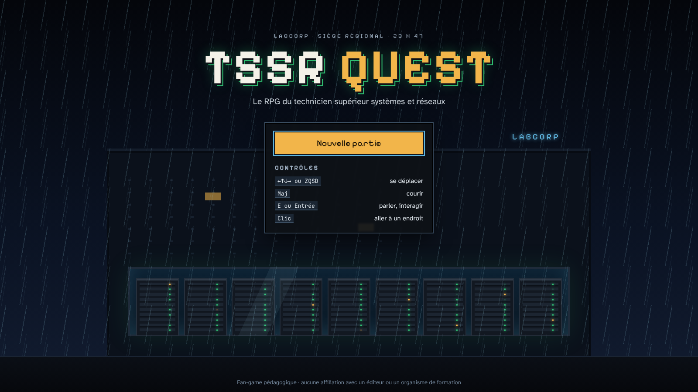
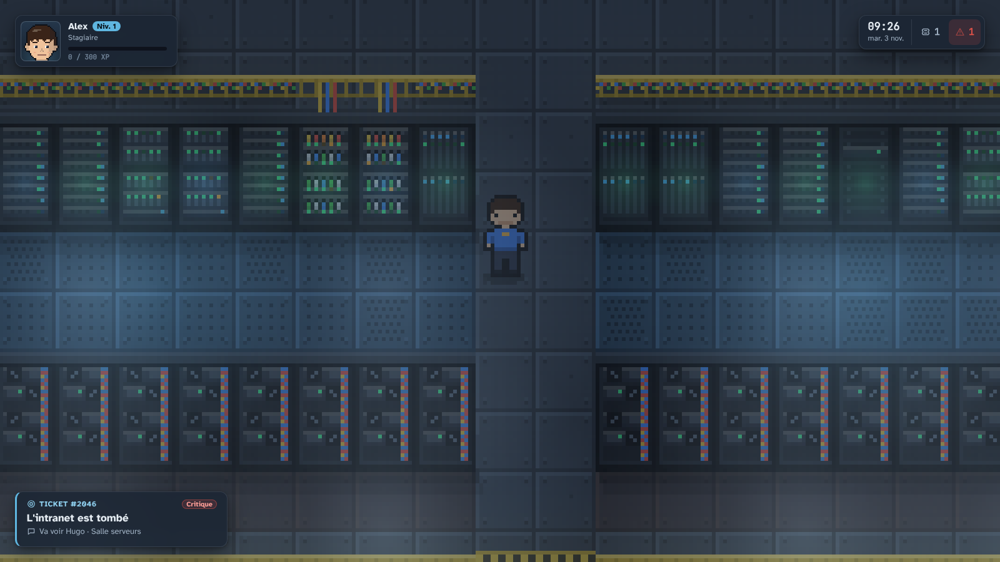
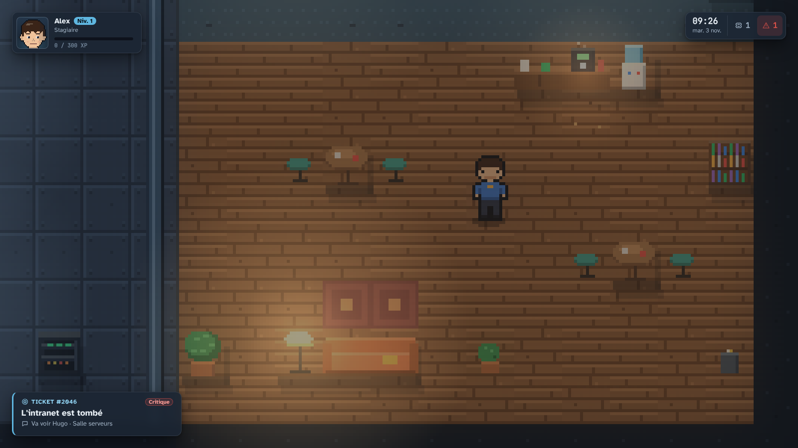
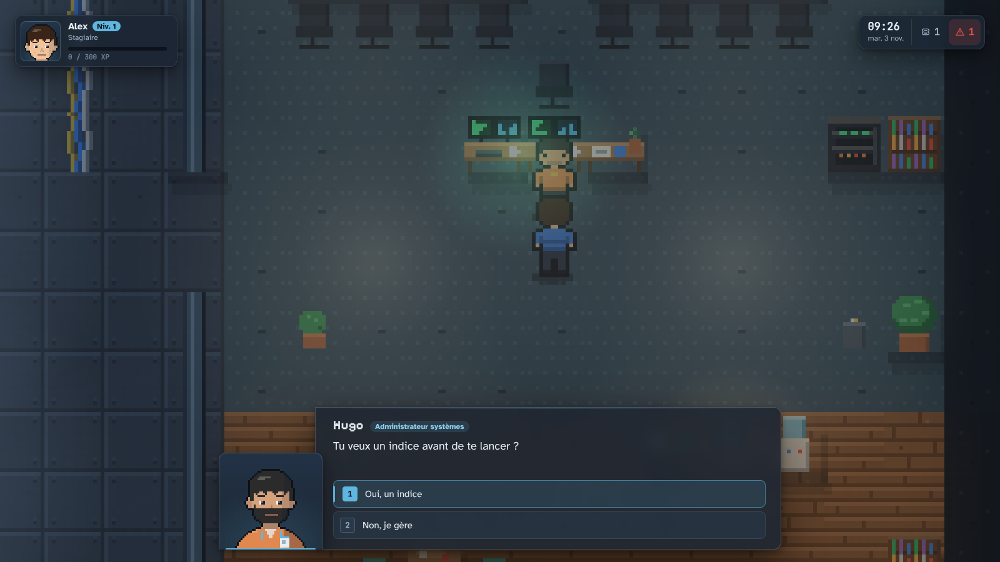
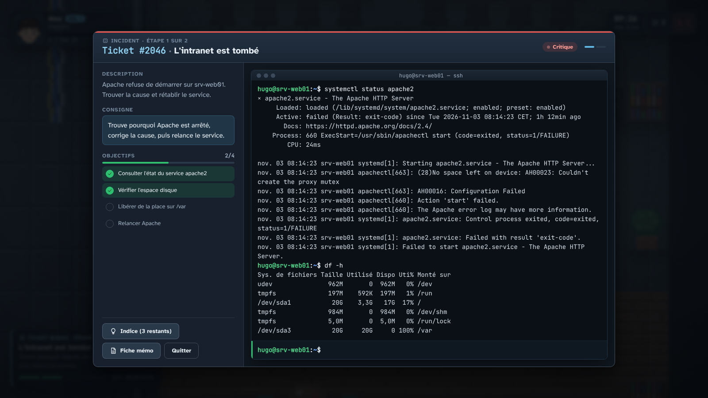
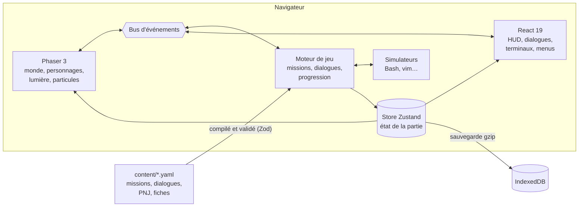

<div align="center">

# TSSR Quest

**Le RPG en pixel art pour apprendre le métier de technicien supérieur systèmes et réseaux.**

Tickets · terminaux Linux simulés · collègues à aider · XP et compétences · 100 % en français

[](https://alexandrebouttierdev.github.io/tssr-quest/)

[](https://github.com/alexandrebouttierdev/tssr-quest/actions/workflows/pages.yml)
[](https://github.com/alexandrebouttierdev/tssr-quest/actions/workflows/ci.yml)
[](LICENSE)


[Jouer](#jouer) · [Le jeu](#le-jeu) · [Ce qui est jouable](#ce-qui-est-jouable) ·
[Les simulateurs](#des-terminaux-fidèles) · [Comment ça marche](#comment-ça-marche) ·
[Développer](#développer) · [Documentation](#documentation)

</div>

---



Tu arrives en alternance chez **LabCorp**, une PME fictive. Au fil des semaines, les collègues
te confient des tickets : un intranet tombé, un disque plein, des comptes à créer, un switch à
configurer. Tu les résous **en tapant de vraies commandes** dans des terminaux simulés, tu
gagnes de l'XP et tu progresses de *Stagiaire* à *Référent·e technique*.

Le jeu suit le programme du titre professionnel **TSSR** (technicien supérieur systèmes et
réseaux), chapitre par chapitre : Linux, Windows Server, Active Directory, réseau Cisco,
virtualisation, sauvegarde, sécurité, supervision.

## Jouer

<div align="center">

<a href="https://alexandrebouttierdev.github.io/tssr-quest/"></a>

</div>

Rien à installer : le jeu tourne dans le navigateur, sur ordinateur comme sur tablette. La
partie est sauvegardée automatiquement **sur ton appareil** (aucun compte, aucun serveur).

| Action | Clavier | Souris ou toucher |
| --- | --- | --- |
| Se déplacer | `←` `↑` `↓` `→` ou `Z` `Q` `S` `D` | Cliquer sur le sol |
| Courir | `Maj` | — |
| Parler, interagir | `E` ou `Entrée` | Cliquer sur un personnage |
| Taper une commande | Clavier, `Entrée` pour valider, `↑` pour l'historique | — |

## Le jeu

- 🗂️ **De vrais tickets** : chaque mission part d'un problème concret, avec un ticket, une
  priorité, des objectifs qui se cochent au fil de ce que tu fais, des indices et une fiche
  mémo à consulter.
- 🖥️ **De vraies commandes** : pas de QCM déguisé. Tu tapes `systemctl status apache2`,
  `df -h`, `sudo rm`… et la machine réagit comme une Debian 12.
- 🧑‍🤝‍🧑 **Des collègues** : Hugo, l'admin système, te guide, te met en garde et commente ce
  que tu as fait. Tes réponses dans les dialogues comptent.
- 📈 **Une progression** : XP, niveaux et titres de poste, compétences par domaine
  (Linux, Windows, réseau…), réputation, badges.
- 🌙 **Un monde en pixel art** : salle serveurs éclairée par les LED des baies, poussière dans
  le flux de la climatisation, néons qui grésillent.

<table>
  <tr>
    <td width="50%"></td>
    <td width="50%"></td>
  </tr>
  <tr>
    <td align="center"><sub>La salle serveurs : allées froides et chaudes</sub></td>
    <td align="center"><sub>Le coin pause, à côté de la supervision</sub></td>
  </tr>
  <tr>
    <td width="50%"></td>
    <td width="50%"></td>
  </tr>
  <tr>
    <td align="center"><sub>Hugo, administrateur systèmes</sub></td>
    <td align="center"><sub>Ticket #2046 : Apache ne démarre plus, /var est plein</sub></td>
  </tr>
</table>

## Ce qui est jouable

> [!NOTE]
> Le jeu est en construction, phase par phase ([feuille de route](docs/11-roadmap.md)).
> Le journal de bord [`PROGRESS.md`](PROGRESS.md) détaille ce qui est fait et ce qui vient.

| Phase | Contenu | État |
| --- | --- | --- |
| 0 — Socle | Monde, déplacements, dialogues, moteur de missions, sauvegarde, première mission au terminal | ✅ Terminée (`v0.1.0`) |
| 1 — Tranche Linux | Chapitres 4 et 5 : commandes de base, vim, processus, archives, comptes, droits, paquets, disques, réseau, cron | 🚧 En cours |
| 2 et suivantes | Windows, Active Directory, réseau Cisco, virtualisation, sauvegarde, sécurité, supervision | 🗓️ Prévu |

## Des terminaux fidèles

Les simulateurs sont écrits en TypeScript pur, sans dépendance, et testés comme du code de
production. L'objectif est qu'un geste appris dans le jeu fonctionne à l'identique sur un
vrai serveur.

- **Shell Bash** : analyseur et interpréteur maison (tubes, redirections, `&&` / `||`,
  variables, globs, arrière-plan, historique), plus de 90 commandes avec leurs options
  courantes (`ls -l`, `grep -r`, `find`, `sed`, `tar`, `chmod`, `useradd`, `systemctl`,
  `journalctl`, `apt`, `dpkg`…) et un éditeur **vim** modal.
- **Une machine cohérente** : système de fichiers avec droits POSIX, comptes et groupes,
  services systemd qui tombent en panne pour de vraies raisons (disque plein, port déjà
  pris), journaux, processus, disques, dépôt APT.
- **Des sorties exactes** : messages d'erreur, formats de date, tri et alignements
  reprennent ceux d'une Debian 12 en français ; sudo, `su`, `passwd` posent leurs questions
  comme en vrai, mot de passe masqué compris.

Chaque mission a une **solution de référence** rejouée automatiquement par les tests : une
mission impossible à finir ne peut pas être publiée.

## Comment ça marche



- **Phaser** dessine le monde, **React** affiche l'interface : ils ne se touchent jamais et
  communiquent par le store et le bus d'événements.
- Le **moteur** et les **simulateurs** sont des modules TypeScript purs, testés dans Node,
  sans Phaser, React ni DOM.
- Les missions sont décrites en **YAML** dans `content/`, validées par des schémas Zod et
  compilées en JSON typé au build.

## Développer

Prérequis : Node.js 22.

```bash
git clone https://github.com/alexandrebouttierdev/tssr-quest.git
cd tssr-quest
npm install
npm run dev            # http://localhost:5173
```

| Commande | Rôle |
| --- | --- |
| `npm run dev` | Serveur de développement Vite |
| `npm run build` | Build de production dans `dist/` |
| `npm run typecheck` | Vérification TypeScript stricte |
| `npm run lint` | ESLint (frontières entre couches comprises) |
| `npm test` | Tests unitaires Vitest |
| `npm run test:coverage` | Couverture, avec seuils par dossier |
| `npm run test:content` | Validation du contenu YAML et rejeu des solutions de référence |
| `npm run test:e2e` | Parcours complets dans Chromium (Playwright) |

Chaque push sur `master` passe la CI (lint, types, tests, contenu, build, E2E) puis
**publie le jeu sur GitHub Pages** via [`pages.yml`](.github/workflows/pages.yml).

<details>
<summary><b>Activer GitHub Pages sur un fork</b></summary>

Dans *Settings → Pages*, choisir **Source : GitHub Actions**. Le workflow construit le jeu
avec le bon chemin de base (`/<nom-du-dépôt>/`) et le publie à chaque push sur `master`.

</details>

## Documentation

| Document | Contenu |
| --- | --- |
| [`docs/00-vision.md`](docs/00-vision.md) | Pitch, public, principes pédagogiques |
| [`docs/01-game-design.md`](docs/01-game-design.md) | Boucle de jeu, XP, niveaux, compétences, réputation, badges |
| [`docs/02-architecture.md`](docs/02-architecture.md) | Stack, arborescence, couches, flux de données |
| [`docs/03-simulateurs.md`](docs/03-simulateurs.md) | Spécification des simulateurs : Bash, PowerShell, Cisco IOS, AD, GLPI… |
| [`docs/04-moteur-missions.md`](docs/04-moteur-missions.md) | Format YAML des missions, étapes, conditions, récompenses |
| [`docs/05-campagne.md`](docs/05-campagne.md) | Les 18 chapitres, mission par mission |
| [`docs/06-monde-et-cartes.md`](docs/06-monde-et-cartes.md) | Zones, PNJ, conventions Tiled |
| [`docs/07-direction-artistique.md`](docs/07-direction-artistique.md) | Pixel art : palette, lumière, particules, son |
| [`docs/08-ui-hud.md`](docs/08-ui-hud.md) | HUD, menus, dialogues, accessibilité |
| [`docs/09-tests-qualite.md`](docs/09-tests-qualite.md) | Tests unitaires, de contenu, E2E, CI |
| [`docs/10-conventions-code.md`](docs/10-conventions-code.md) | Conventions de code et de Git |
| [`docs/11-roadmap.md`](docs/11-roadmap.md) | Phases, tâches et critères de validation |
| [`PROGRESS.md`](PROGRESS.md) | Journal de bord : décisions, problèmes, prochaine étape |

## Licence

- **Code** : [MIT](LICENSE).
- **Contenu** (`content/` : missions, dialogues, fiches) et **assets originaux** :
  [CC BY-NC 4.0](https://creativecommons.org/licenses/by-nc/4.0/deed.fr).
- Polices et ressources tierces : voir [`CREDITS.md`](CREDITS.md).

## Avertissement

TSSR Quest est un projet personnel et pédagogique, réalisé par un apprenant de la promotion TSSR de l'ENI École Informatique. Il n'est ni produit, ni validé, ni soutenu officiellement par l'ENI ou par le ministère du Travail. LabCorp et tous les personnages sont fictifs. Les marques citées (Microsoft, Cisco, VMware, GLPI, Debian…) appartiennent à leurs propriétaires et ne sont mentionnées qu'à des fins d'apprentissage.

## Auteur

**Alexandre Bouttier** — développeur fullstack en reconversion vers l'administration systèmes et réseaux, à la recherche d'un stage TSSR.
