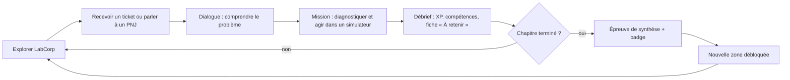

# 01 — Game design

## Boucle de jeu

- **Boucle courte (5 à 15 min)** : un ticket, une mission, une récompense.
- **Boucle moyenne (1 à 3 h)** : un chapitre, une épreuve, un badge, une zone.
- **Boucle longue (40 à 60 h)** : la campagne, de stagiaire à référent technique, et l'intrigue de la porte dérobée.

## Personnage joueur

- Création au début : prénom, apparence (6 coiffures, 8 couleurs de cheveux, 6 tons de peau, 8 tenues), pronoms (il, elle, iel) utilisés dans les dialogues.
- Pas de statistiques de combat : la puissance du joueur, ce sont ses **compétences** et ses **outils**.

## XP et niveaux

| Source | XP |
| --- | --- |
| Étape de mission réussie | 20 |
| Bonus sans erreur ni indice sur l'étape | +10 |
| Mission terminée | +50 |
| Quête secondaire terminée | +30 à +80 |
| Épreuve de chapitre réussie | +200 (+100 si note ≥ 16/20) |
| Mission rejouée en révision | 25 % de l'XP normale, plafonné à 3 fois par jour réel |

Dix niveaux, chacun associé à un titre de poste affiché dans le HUD.

| Niveau | Titre | XP cumulée |
| --- | --- | --- |
| 1 | Stagiaire | 0 |
| 2 | Technicien·ne support N1 | 300 |
| 3 | Technicien·ne support N2 | 800 |
| 4 | Technicien·ne de proximité | 1 500 |
| 5 | Technicien·ne systèmes | 2 500 |
| 6 | Technicien·ne réseau | 3 800 |
| 7 | Administrateur·rice systèmes et réseaux | 5 400 |
| 8 | Administrateur·rice infrastructures | 7 300 |
| 9 | TSSR confirmé·e | 9 500 |
| 10 | Référent·e technique | 12 000 |

La courbe est calibrée pour qu'un joueur qui fait toutes les missions principales atteigne le niveau 9 à la fin du chapitre 18, et le niveau 10 avec les quêtes secondaires.

Une montée de niveau déclenche une animation plein écran (badge qui tombe, confettis pixel, jingle) et débloque un élément cosmétique (tenue, accessoire de bureau).

## Compétences

Huit compétences, chacune de 0 à 100 points :

| Compétence | Alimentée par |
| --- | --- |
| Support et ITIL | M365, tickets, GLPI, communication |
| Réseau | Bases réseaux, switch, routage, Wi-Fi |
| Windows | Clients Windows, Windows Server, AD, GPO |
| Linux | Utilisation et administration Linux |
| Virtualisation et cloud | VMware Workstation, vSphere, cloud |
| Sécurité | Pare-feu, DMZ, VPN, PKI, bonnes pratiques |
| Scripting et automatisation | Bash, PowerShell, automatisation, IA |
| Sauvegarde et supervision | Sauvegarde, restauration, supervision |

Chaque mission déclare dans son YAML les points qu'elle donne (`skills: { linux: 12, support: 3 }`).

**Paliers et avantages** (identiques pour chaque compétence, contextualisés) :

| Palier | Avantage |
| --- | --- |
| 25 | Un indice gratuit par mission du domaine |
| 50 | Autocomplétion Tab dans les simulateurs du domaine |
| 75 | Les fiches du domaine montrent des exemples avancés |
| 100 | Titre honorifique (« Gourou Linux », « Maître des VLAN »…) + tenue exclusive |

## Inventaire

Les objets ouvrent des actions dans le monde ou dans les missions.

| Catégorie | Exemples | Effet |
| --- | --- | --- |
| Outils | Testeur de câble, pince à sertir, câble console bleu, tournevis, bracelet antistatique, clé USB d'installation | Requis par certaines étapes (« il te faut un câble console pour accéder au switch ») |
| Badges d'accès | Local technique, salle serveurs, datacenter, SOC | Ouvrent des portes de zones |
| Objets de quête | Post-it de Gégé, disque dur suspect, carte réseau neuve | Font avancer une quête |
| Consommables | Café (le seul !) : relance l'énergie… et une réplique drôle | Aucun effet mécanique sérieux |
| Cosmétiques | Mug, plante de bureau, sticker « It works on my machine » | Décorent le poste du joueur |

Pas de gestion de poids ni de vente : l'inventaire est une collection, pas une contrainte.

## Réputation

Cinq services ont une jauge de satisfaction de 0 à 100 : Accueil, Comptabilité, Commercial (Rennes), Production, Direction.

- Ticket résolu dans les délais : +3 à +8.
- Ticket résolu en retard : +1.
- Choix de dialogue maladroit ou condescendant : −2 à −5.
- Seuils à 40, 70 et 90 : nouvelles quêtes secondaires, répliques, cadeaux (cosmétiques).

La réputation ne bloque jamais la campagne principale.

## Journée de travail et tickets

- Le temps de jeu avance pendant l'exploration (1 minute réelle ≈ 10 minutes de jeu) et s'arrête dans les menus et les missions.
- Une journée : arrivée à 8 h 30, tickets qui tombent au fil de la matinée, réunion à 14 h (scène ou événement), départ vers 18 h. Le joueur peut « finir sa journée » à tout moment après 17 h.
- Chaque ticket a une priorité (basse, normale, haute, critique) et un délai cible (SLA). Le délai ne court que pour les tickets de quête secondaire ; les missions principales n'ont pas de chrono sauf annonce explicite.
- Le soir, certains jours : **astreinte** optionnelle (incident nocturne, XP doublée).
- Cycle visuel jour/nuit et météo (pluie fréquente à Rennes, comme il se doit).

## Épreuves et badges

Chaque chapitre se termine par une épreuve de synthèse :

- Une mission longue qui combine les notions du chapitre.
- Une note sur 20 calculée (objectifs atteints, erreurs, indices, méthode).
- Un badge (« Badge Linux Admin ») affiché dans le profil, téléchargeable en image pour être partagé.

Les mises en situation professionnelle (chapitres 6 et 10) prennent la forme d'un **cahier des charges** remis par Sophie, avec des livrables à rendre et une soutenance en dialogue.

L'ensemble des badges mène à l'**attestation de fin d'alternance** et à l'écran de fin.

## Indices et aide

- `aide` (ou `?`, `man`, `Get-Help`) dans chaque simulateur : jamais pénalisé.
- Bouton **Indice** : trois niveaux progressifs (piste, commande, solution). Chaque niveau retire le bonus sans erreur de l'étape.
- Bouton **Fiche** : ouvre l'antisèche liée, débloquée par les missions précédentes.

## Difficulté

Trois modes choisis au début, modifiables à tout moment :

| Mode | Effet |
| --- | --- |
| Découverte | Indices gratuits, objectifs détaillés, explications longues |
| Formation (défaut) | Comportement décrit ci-dessus |
| Examen | Objectifs vagues, pas d'indice, variantes aléatoires systématiques, XP +25 % |

## Quêtes secondaires

Environ 40, réparties dans les zones, pour approfondir ou détendre :

- « Le mystère des post-its de Gégé » (collecte, fil rouge sécurité).
- « Café en panne » : réparer la machine à café connectée… qui est sur le VLAN des serveurs.
- « La plante de la compta » : arroser la plante pendant une semaine (gag, cosmétique).
- « Retrogaming » : remettre en route un vieux PC sous Windows XP pour la pause déjeuner (notions historiques).
- Révisions de la promo : défis lancés par le formateur ENI, rejouables.

## Mort, échec, sauvegarde

- Aucun game over. Une mission ratée peut être reprise depuis l'étape en cours ou depuis le début.
- Les commandes destructrices ont des conséquences jouables : un `rm -rf` mal placé ouvre une mini-quête de restauration depuis la sauvegarde.
- Sauvegarde automatique à chaque fin d'étape et changement de zone ; trois emplacements manuels ; export/import en fichier JSON.
