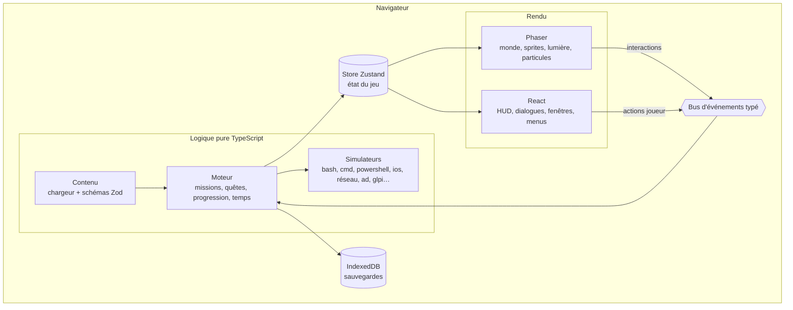
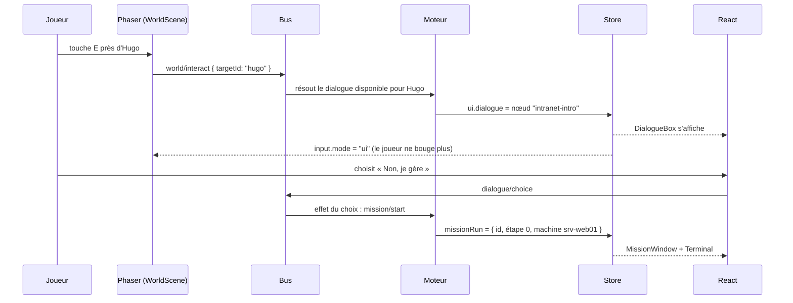

# 02 — Architecture technique

Ce document fait foi pour l'emplacement de chaque fichier. Toute nouvelle brique s'y ajoute.

## Vue d'ensemble



Trois règles structurent tout :

1. **La logique est pure.** `src/core`, `src/engine`, `src/sims`, `src/content` n'importent ni Phaser, ni React, ni le DOM. Ils tournent dans Node pour les tests.
2. **Un seul état de vérité** : le store Zustand (`src/core/store`). Phaser et React le lisent ; seuls le moteur et des actions explicites le modifient.
3. **Communication par événements typés** entre le monde (Phaser), l'interface (React) et le moteur.

## Stack

| Brique | Choix | Pourquoi |
| --- | --- | --- |
| Langage | TypeScript (strict) | Sûreté, autocomplétion, contrats entre couches |
| Monde 2D | Phaser 3 (dernière 3.x stable) | Mûr, documenté, tilemaps Tiled, Arcade Physics, Light2D, FX |
| Interface | React 19 | Composants riches (terminaux, consoles), écosystème, compétence de l'auteur |
| Animations UI | Motion (`motion/react`) | Transitions fluides, respect de `prefers-reduced-motion` |
| État | Zustand (+ `zustand/vanilla`) | Lisible depuis React (hooks) et depuis Phaser (store vanilla) |
| Immutabilité | Immer (middleware Zustand) | Mises à jour lisibles de l'état imbriqué |
| Validation | Zod | Schémas du contenu, des sauvegardes, des configs |
| Contenu | YAML (`yaml`) compilé en JSON au build | Lisible et éditable par des non-développeurs |
| Cartes | Tiled (export `.tmj`) | Standard, supporté nativement par Phaser |
| Sauvegarde | IndexedDB via `idb-keyval` | Simple, asynchrone, volumineux |
| Build | Vite | Rapide, HMR, plugins |
| PWA | `vite-plugin-pwa` | Jouable hors ligne, installable sur mobile |
| Tests unitaires | Vitest + `@vitest/coverage-v8` | Rapide, compatible Vite |
| Tests React | Testing Library + `happy-dom` | Tests orientés utilisateur |
| Tests E2E | Playwright | Parcours réels dans le navigateur |
| Qualité | ESLint (`typescript-eslint`, `eslint-plugin-react-hooks`), Prettier | Style homogène |
| Hooks Git | `simple-git-hooks` + `lint-staged` | Lint et tests rapides avant commit |
| CI/CD | GitHub Actions | Lint, types, tests, contenu, build, E2E, déploiement |

Les versions exactes sont fixées par `npm install` au moment de l'initialisation ; utiliser les dernières versions stables.

## Arborescence complète

```
tssr-quest/
├── CLAUDE.md
├── README.md
├── CREDITS.md                      # crédits assets, polices, sons
├── LICENSE                         # MIT pour le code, CC BY-NC 4.0 pour le contenu (à confirmer)
├── index.html
├── package.json
├── tsconfig.json                   # base stricte
├── tsconfig.node.json              # scripts et configs
├── vite.config.ts
├── vitest.config.ts
├── playwright.config.ts
├── eslint.config.js
├── .prettierrc
├── .github/
│   └── workflows/
│       ├── ci.yml                  # lint, typecheck, tests, contenu, build, e2e
│       └── deploy.yml              # déploiement sur le VPS (rsync) à chaque tag
├── docs/                           # ce dossier de conception
├── reference/                      # prototypes de la phase de conception (lecture seule)
├── assets/                         # sources des assets (non servies telles quelles)
│   ├── palette.gpl
│   ├── aseprite/                   # fichiers sources .aseprite
│   └── generators/                 # scripts de génération pixel art (Node)
├── public/
│   ├── fonts/
│   ├── audio/{music,sfx,ambience}/
│   ├── sprites/                    # spritesheets + atlas JSON
│   ├── tilesets/
│   ├── maps/                       # cartes .tmj copiées depuis content/maps
│   └── icons/                      # icônes PWA
├── content/                        # tout le contenu du jeu, en français
│   ├── chapters/
│   │   ├── 01-microsoft-365/
│   │   │   ├── chapter.yaml        # métadonnées du chapitre
│   │   │   ├── m365-premier-jour.mission.yaml
│   │   │   └── …
│   │   └── …                       # un dossier par chapitre (voir 05-campagne.md)
│   ├── dialogues/                  # un fichier par PNJ
│   │   └── hugo.dialogue.yaml
│   ├── npcs/                       # fiches PNJ (sprite, portrait, voix, routine)
│   ├── items/items.yaml
│   ├── sheets/                     # fiches « À retenir » (markdown)
│   ├── side-quests/
│   ├── zones/zones.yaml
│   └── maps/                       # cartes Tiled .tmj
├── scripts/
│   ├── build-content.ts            # YAML → JSON validé (src/content/generated)
│   ├── validate-content.ts         # cohérence globale du contenu
│   └── replay-solutions.ts         # rejoue la solution de chaque mission
├── src/
│   ├── main.tsx                    # point d'entrée : monte React et Phaser
│   ├── app/                        # racine React
│   │   ├── App.tsx
│   │   ├── GameCanvas.tsx          # crée et détruit l'instance Phaser
│   │   └── providers.tsx
│   ├── core/                       # socle sans dépendance de rendu
│   │   ├── model.ts                # types partagés (compétences, services, MissionResult…)
│   │   ├── events/                 # bus d'événements typé
│   │   │   ├── bus.ts
│   │   │   ├── events.ts           # union de tous les événements
│   │   │   └── bus.test.ts
│   │   ├── store/                  # store Zustand découpé en tranches
│   │   │   ├── index.ts
│   │   │   ├── player.slice.ts
│   │   │   ├── progress.slice.ts
│   │   │   ├── inventory.slice.ts
│   │   │   ├── reputation.slice.ts
│   │   │   ├── time.slice.ts
│   │   │   ├── ui.slice.ts
│   │   │   ├── settings.slice.ts
│   │   │   ├── progression.slice.ts
│   │   │   ├── mission-run.slice.ts  # vue de la mission en cours publiée par le moteur
│   │   │   ├── create-store.ts     # fabrique createGameStore + store global
│   │   │   ├── use-game-store.tsx  # hook React useGameStore + fournisseur
│   │   │   └── *.test.ts
│   │   ├── save/                   # sauvegarde, migrations de version
│   │   │   ├── save-manager.ts
│   │   │   ├── save.schema.ts
│   │   │   ├── migrations.ts
│   │   │   └── *.test.ts
│   │   ├── random/                 # générateur pseudo-aléatoire avec graine
│   │   └── utils/
│   ├── engine/                     # règles du jeu
│   │   ├── missions/
│   │   │   ├── mission-runner.ts   # exécute une mission étape par étape
│   │   │   ├── step-registry.ts    # associe un type d'étape à son gestionnaire
│   │   │   ├── steps/              # un gestionnaire par type d'étape
│   │   │   │   ├── choice.step.ts
│   │   │   │   ├── input.step.ts
│   │   │   │   ├── ordering.step.ts
│   │   │   │   ├── terminal.step.ts
│   │   │   │   └── …
│   │   │   ├── conditions.ts       # évaluateur des conditions de réussite
│   │   │   ├── rewards.ts
│   │   │   └── *.test.ts
│   │   ├── quests/                 # graphe de quêtes, prérequis, journal
│   │   ├── dialogue/               # interpréteur de dialogues (nœuds, choix, effets)
│   │   ├── progression/            # XP, niveaux, compétences, avantages
│   │   ├── time/                   # horloge, journée, tickets et SLA, météo
│   │   ├── tickets/                # file de tickets secondaires générés
│   │   └── grading/                # notation des épreuves sur 20
│   ├── sims/                       # simulateurs (voir 03-simulateurs.md)
│   │   ├── shared/                 # machine virtuelle commune : fs, utilisateurs, services…
│   │   ├── bash/
│   │   ├── cmd/
│   │   ├── powershell/
│   │   ├── ios/
│   │   ├── network/
│   │   ├── directory/              # Active Directory, GPO
│   │   ├── ticketing/              # GLPI simulé
│   │   ├── virtualization/
│   │   ├── firewall/
│   │   ├── backup/
│   │   ├── vim/
│   │   └── index.ts                # registre des simulateurs
│   ├── content/                    # chargement et typage du contenu
│   │   ├── schemas/                # schémas Zod (mission, dialogue, npc, item, zone)
│   │   ├── loader.ts
│   │   ├── generated/              # JSON produit par scripts/build-content.ts (ignoré par Git)
│   │   └── *.test.ts
│   ├── game/                       # tout ce qui dépend de Phaser
│   │   ├── config.ts               # configuration Phaser (pixelArt, scale, physics)
│   │   ├── scenes/
│   │   │   ├── BootScene.ts
│   │   │   ├── PreloadScene.ts
│   │   │   ├── TitleScene.ts
│   │   │   ├── WorldScene.ts
│   │   │   └── TransitionScene.ts
│   │   ├── entities/
│   │   │   ├── Player.ts
│   │   │   ├── Npc.ts
│   │   │   ├── Interactable.ts
│   │   │   └── Door.ts
│   │   ├── systems/
│   │   │   ├── map-loader.ts       # lit les calques Tiled, crée collisions et entités
│   │   │   ├── input.ts            # clavier, manette, toucher, clic
│   │   │   ├── pathfinding.ts      # A* (logique pure, testée)
│   │   │   ├── lighting.ts         # Light2D, cycle jour/nuit
│   │   │   ├── fx.ts               # bloom, vignette, transitions
│   │   │   ├── particles.ts
│   │   │   ├── npc-routines.ts
│   │   │   └── camera.ts
│   │   ├── animations/             # définitions des animations de sprites
│   │   └── bridge.ts               # abonnements store/bus côté Phaser
│   ├── ui/                         # tout ce qui dépend de React
│   │   ├── hud/
│   │   ├── dialogue/
│   │   ├── mission/                # cadre de mission + composants de simulateurs
│   │   │   ├── MissionWindow.tsx
│   │   │   ├── Terminal/
│   │   │   ├── VimEditor/
│   │   │   ├── NetworkDiagram/
│   │   │   ├── PatchPanel/
│   │   │   ├── DirectoryConsole/
│   │   │   ├── TicketDesk/
│   │   │   ├── VirtualizationConsole/
│   │   │   ├── FlowMatrix/
│   │   │   └── BackupPlanner/
│   │   ├── menus/                  # journal, inventaire, compétences, fiches, carte, options
│   │   ├── notifications/
│   │   ├── title/                  # écran titre, création du personnage
│   │   ├── components/             # boutons, fenêtres, barres, onglets
│   │   ├── hooks/
│   │   ├── strings/                # textes d'interface en français
│   │   └── styles/                 # tokens CSS, thème
│   ├── audio/
│   │   └── audio-manager.ts
│   └── platform/
│       ├── storage.ts              # accès IndexedDB
│       ├── viewport.ts             # mise à l'échelle entière
│       └── device.ts               # détection tactile, performances
└── tests/
    ├── e2e/                        # Playwright
    └── fixtures/                   # états de machine, sauvegardes de test
```

## Le store Zustand

Un store unique, créé avec `createStore` de `zustand/vanilla` (accessible partout), exposé à React par un hook `useGameStore(selector)`.

| Tranche | Contenu |
| --- | --- |
| `player` | Prénom, apparence, pronoms, zone courante, position, direction |
| `progress` | Chapitre courant, missions terminées (avec note, erreurs, indices), quêtes actives, drapeaux narratifs, badges |
| `progression` | XP, niveau, points par compétence, avantages débloqués |
| `inventory` | Objets possédés, objets équipés |
| `reputation` | Jauge par service |
| `time` | Jour, heure de jeu, météo par site, astreinte |
| `tickets` | Tickets secondaires ouverts et leur SLA |
| `ui` | Mode d'entrée (`world` / `ui`), fenêtre ouverte, dialogue courant, notifications |
| `settings` | Volumes, vitesse du texte, accessibilité, difficulté |
| `missionRun` | Vue de la mission en cours publiée par le moteur : id, étape, objectifs, sortie du terminal, indices révélés (l'état des simulateurs reste dans le moteur) |

Les tranches `ui` et `missionRun` ne sont pas sauvegardées telles quelles ; une mission interrompue reprend au début de l'étape en cours.

## Le bus d'événements

Un bus maison, typé par une union discriminée, qui sert de frontière entre les couches.

```ts
/**
 * Tous les événements qui circulent entre le monde, l'interface et le moteur.
 * Ajouter un événement ici oblige à le traiter là où il est attendu.
 */
export type GameEvent =
  | { type: 'world/interact'; targetId: string }            // le joueur interagit avec un PNJ ou un objet
  | { type: 'world/zone-entered'; zoneId: string }
  | { type: 'dialogue/advance' }                             // réplique suivante
  | { type: 'dialogue/choice'; nodeId: string; choiceId: string }
  | { type: 'mission/start'; missionId: string }
  | { type: 'mission/step-input'; payload: unknown }       // saisie du joueur dans une étape
  | { type: 'mission/hint-requested' }
  | { type: 'mission/abandon' }
  | { type: 'mission/continue' }                             // étape terminée : passer à la suite
  | { type: 'mission/completed'; missionId: string; result: MissionResult }
  | { type: 'progression/level-up'; level: number }
  | { type: 'ui/notify'; message: string; kind: 'info' | 'success' | 'warning' }
  | { type: 'audio/play'; sound: SoundId };
```

## Cycle d'une interaction



## Scènes Phaser

| Scène | Rôle |
| --- | --- |
| `BootScene` | Charge le minimum (police, barre de chargement) |
| `PreloadScene` | Charge atlas, tilesets, cartes, sons ; affiche la progression |
| `TitleScene` | Fond animé de l'écran titre (l'interface du titre est en React) |
| `WorldScene` | Carte active, joueur, PNJ, interactions, lumière, particules, caméra |
| `TransitionScene` | Fondus et écrans de transport entre zones |

Une seule `WorldScene` recharge la carte à chaque changement de zone (pas une scène par zone).

## Pipeline de contenu

1. Les auteurs écrivent du YAML dans `content/`.
2. `npm run content:build` (lancé aussi par `dev` et `build`) lit tout le YAML, valide chaque fichier avec les schémas Zod de `src/content/schemas`, vérifie les références croisées (PNJ, zones, objets, fiches existent), puis écrit des JSON typés dans `src/content/generated/`.
3. En dev, un plugin Vite surveille `content/` et relance la compilation à chaud.
4. `npm run test:content` rejoue la `solution` de chaque mission sur son simulateur et vérifie que tous les objectifs sont atteints.

## Sauvegarde

- Format : JSON validé par un schéma Zod versionné (`version: 1`), compressé avec `CompressionStream` si disponible.
- Emplacements : `auto`, `slot-1`, `slot-2`, `slot-3`.
- Migrations : `migrations.ts` contient une fonction par changement de version ; testées une par une.
- Export / import d'un fichier `.tssrsave` depuis les options.

## Performance

- Atlas de textures (un par famille) pour limiter les changements de texture.
- Cartes de 40 × 25 tuiles maximum, calques statiques mis en cache.
- Composants React lourds (consoles) chargés à la demande (`React.lazy`).
- Simulateurs chargés à la demande par mission (import dynamique).
- Budget : premier chargement < 5 Mo hors musique, 60 i/s sur un portable de 2020.

## Déploiement

- Build statique dans `dist/`, servi par Nginx sur le VPS (en-têtes de cache longs pour les fichiers hachés, `index.html` sans cache).
- Domaine à choisir (ex. `tssrquest.fr`), HTTPS Let's Encrypt.
- Page itch.io en complément pour la visibilité.
- Déploiement automatique à chaque tag `v*` par `deploy.yml`.
