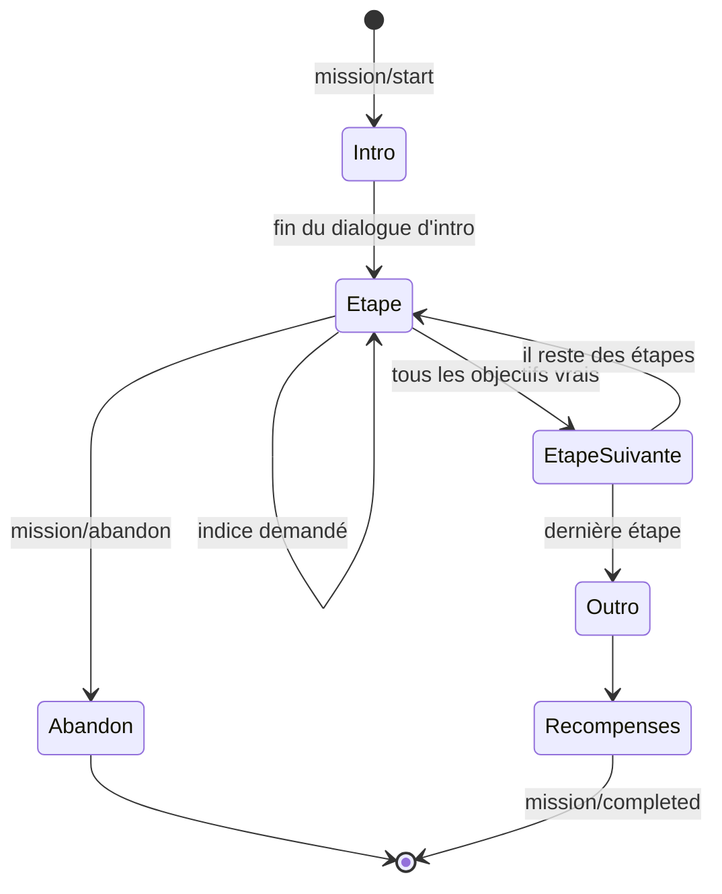

# 04 — Moteur de missions, quêtes et dialogues

Le contenu du jeu (missions, dialogues, PNJ, objets) est écrit en **YAML** dans `content/` et validé par des schémas **Zod** dans `src/content/schemas/`. Ajouter une mission ne demande pas de code tant qu'elle utilise des types d'étapes existants.

## Chapitre

`content/chapters/05-linux-admin/chapter.yaml`

```yaml
id: linux-admin
number: 5
title: Administration de GNU/Linux
eniModule: "Administration d'une distribution GNU/Linux (1/2 et 2/2)"
period: { from: 2026-11-09, to: 2026-11-20 }
zones: [salle-serveurs]
mentor: hugo
unlocks: { zones: [], items: [badge-serveurs] }
missions:                       # ordre de la campagne principale
  - linux-admin.installer-debian
  - linux-admin.paquets
  - linux-admin.boot
  - linux-admin.comptes
  - linux-admin.droits
  - linux-admin.disque
  - linux-admin.ip-fixe
  - linux-admin.processus
  - linux-admin.cron
  - linux-admin.intranet-down
exam: linux-admin.epreuve-serveur-web
badge: { id: badge-linux-admin, name: Badge Linux Admin }
```

## Mission

```yaml
id: linux-admin.intranet-down
chapter: linux-admin
title: L'intranet est tombé
summary: Apache refuse de démarrer sur srv-web01. Trouver la cause et rétablir le service.
giver: hugo
zone: salle-serveurs
requires:                        # prérequis (missions, drapeaux, objets, niveau)
  missions: [linux-admin.cron]
ticket: { number: 2046, priority: critique, requester: karim, service: commercial }
rewards:
  xp: 150
  skills: { linux: 12, support: 3 }
  reputation: { commercial: 6 }
  items: []
  sheets: [fiche-systemctl, fiche-espace-disque]
dialogue:
  intro: hugo#intranet-intro
  outro: hugo#intranet-outro
  abandon: hugo#intranet-abandon

machines:                        # machines simulées utilisées par la mission
  srv-web01:
    base: debian-server
    hostname: srv-web01
    session: { user: hugo, cwd: /home/hugo }
    sudoers: [hugo]
    services:
      apache2: { state: failed, failure: no-space-left }
    disks:
      - { mount: /var, size: 20G, used: 20G }
    files:
      /var/log/debug.log: { size: 18G, owner: root, group: adm, mode: "0640" }
      /home/hugo/notes-astreinte.txt:
        content: |
          - Apache sur srv-web01
          - Toujours lire le statut avant de redémarrer

steps:
  - id: diagnostic
    type: terminal
    sim: bash
    machine: srv-web01
    goal: Trouve pourquoi Apache est arrêté, corrige la cause, puis relance le service.
    objectives:
      - id: status
        label: Consulter l'état du service apache2
        when: { command: { matches: "systemctl status apache2" } }
      - id: disk
        label: Vérifier l'espace disque
        when: { command: { matches: "^df\\b" } }
      - id: free
        label: Libérer de la place sur /var
        when: { disk: { mount: /var, usageBelow: 80 } }
      - id: restart
        label: Relancer Apache
        when: { service: { name: apache2, state: active } }
    hints:
      - Commence par l'état du service, le message d'erreur dit souvent tout.
      - "Les commandes utiles : systemctl status apache2, df -h, ls -lh /var/log"
      - "Solution : sudo rm /var/log/debug.log puis sudo systemctl restart apache2"
    solution:                    # rejouée par npm run test:content
      - systemctl status apache2
      - df -h
      - ls -lh /var/log
      - sudo rm /var/log/debug.log
      - sudo systemctl restart apache2

  - id: prevention
    type: choice
    question: Comment éviter que /var se remplisse de nouveau ?
    options:
      - text: Configurer logrotate et une alerte de supervision à 80 %
        correct: true
      - text: Supprimer /var/log chaque matin
        feedback: Tu perdrais les journaux dont tu as besoin pour diagnostiquer.
      - text: Désactiver les journaux
      - text: Agrandir le disque à chaque incident
    explain: logrotate compresse et purge les anciens journaux ; la supervision prévient avant la panne.

recap:
  - systemctl status puis journalctl avant toute action.
  - df -h et ls -lh pour trouver ce qui remplit un disque.
  - Un service qui ne démarre pas a toujours une raison écrite quelque part.

variants:                        # révision : une variante tirée au hasard remplace des valeurs
  - id: mysql
    replace:
      services: { apache2: null, mariadb: { state: failed, failure: no-space-left } }
      files: { /var/log/debug.log: null, /var/log/mysql/slow.log: { size: 17G } }
```

## Types d'étapes

| `type` | Champs propres | Réussite |
| --- | --- | --- |
| `dialogue` | `node` | Fin du nœud de dialogue |
| `choice` | `question`, `options[]` (`text`, `correct`, `feedback`), `multiple` | Bonne(s) option(s) choisie(s) |
| `input` | `question`, `answers[]` ou `pattern`, `normalize` (`lower`, `trim`, `nospace`, `ip`) | Réponse acceptée |
| `ordering` | `question`, `items[]` (ordre correct) | Ordre exact |
| `matching` | `question`, `pairs[]` | Toutes les paires associées |
| `terminal` | `sim` (`bash`, `cmd`, `powershell`, `ios`), `machine` ou `device`, `goal`, `objectives[]` | Tous les objectifs vrais |
| `editor` | `machine`, `file`, `goal`, `objectives[]` | Contenu du fichier valide (conditions) |
| `diagram` | `topology` (départ), `palette` (équipements disponibles), `objectives[]` | Conditions sur la topologie et tests de paquets |
| `patch-panel` | `ports`, `expected` | Câblage attendu |
| `directory` | `domain` (état de départ), `objectives[]` | Conditions sur l'annuaire |
| `ticket-desk` | `tickets[]`, `objectives[]` | Tickets qualifiés et traités comme attendu |
| `virtualization` | `inventory`, `objectives[]` | Conditions sur l'inventaire |
| `flow-matrix` | `zones`, `expectedFlows`, `forbiddenFlows` | Flux attendus autorisés, interdits bloqués |
| `backup-plan` | `scenario`, `objectives[]` | Conditions sur les jobs et la restauration |
| `script` | `sim` (`bash`, `powershell`), `machine`, `file`, `tests[]` | Le script passe les cas de test |

Chaque étape accepte aussi : `id`, `hints[]` (3 niveaux), `sheet` (fiche liée), `timeLimit` (secondes, rare), `xp` (surcharge des 20 par défaut).

## Conditions de réussite

Les objectifs se vérifient sur l'**état** des simulateurs, ce qui accepte toutes les façons correctes de faire.

| Condition | Exemple | Sens |
| --- | --- | --- |
| `command` | `{ matches: "systemctl status apache2" }` | Une commande correspondant à l'expression a été exécutée avec succès |
| `file` | `{ path: /etc/fstab, contains: "/dev/vg0/data" }` | Contenu, existence, droits (`mode`, `owner`) |
| `service` | `{ name: apache2, state: active, enabled: true }` | État d'un service |
| `user` | `{ name: julie.martin, exists: true, groups: [compta] }` | Compte et appartenances |
| `disk` | `{ mount: /var, usageBelow: 80 }` | Occupation, montage |
| `net` | `{ machine: pc1, ip: 192.168.10.12/24, gateway: 192.168.10.254 }` | Configuration réseau |
| `ping` | `{ from: pc1, to: srv-dc01, expect: success }` | Test de joignabilité calculé par le moteur réseau |
| `ios` | `{ device: sw1, configHas: "switchport mode trunk", on: Gi0/1 }` | Ligne de configuration présente |
| `ad` | `{ object: "CN=Julie Martin,OU=Comptabilite", effectiveRight: { share: Compta, right: modify } }` | Annuaire et droits effectifs |
| `gpo` | `{ user: julie.martin, computer: PC-COMPTA-03, applies: map-z }` | Résultat de stratégie |
| `ticket` | `{ id: 2051, status: resolved, priority: haute }` | État d'un ticket |
| `custom` | `{ fn: checkAgdlp }` | Fonction TypeScript nommée, testée, pour les cas complexes |

Combinaisons : `all: [...]`, `any: [...]`, `not: {...}`.

## Dialogues

`content/dialogues/hugo.dialogue.yaml`

```yaml
npc: hugo
nodes:
  intranet-intro:
    - say: Ah, te voilà ! L'intranet est tombé depuis 8 h et les commerciaux de Rennes me harcèlent.
      mood: inquiet
    - say: C'est srv-web01, une Debian avec Apache. Je t'ouvre une session SSH.
    - say: Tu veux un indice avant de te lancer ?
      choices:
        - text: Oui, un indice
          then:
            - say: Commence toujours par l'état du service. Le message d'erreur dit souvent tout.
        - text: Non, je gère
          effects: [{ flag: hugo-confiance }]
          then:
            - say: J'aime cette confiance. Tape « aide » si tu bloques.
    - effects: [{ startStep: diagnostic }]

  intranet-outro:
    - say: Un /var plein à cause d'un log de debug de 18 Go… grand classique !
      mood: content
    - if: { flag: hugo-confiance }
      say: Et sans indice, en plus. Je vais finir par te laisser les clés de la salle serveurs.
    - say: Pense à logrotate. Ticket clos, merci !

  default:
    - say: Si tu as un doute, relis les journaux. Toujours les journaux.
```

**Effets disponibles** : `flag`, `unflag`, `reputation`, `giveItem`, `takeItem`, `startMission`, `startStep`, `unlockZone`, `unlockSheet`, `playSound`, `wait`, `moveNpc`, `cutscene`.

**Conditions sur un nœud** (`if`) : `flag`, `missionDone`, `hasItem`, `level`, `skill`, `reputation`, `timeOfDay`, `weather`.

**Sélection du dialogue d'un PNJ** : le moteur choisit, par ordre de priorité, l'intro d'une mission disponible, l'outro d'une mission terminée non débriefée, une réplique liée à une quête secondaire, puis `default`.

## Exécution d'une mission (`MissionRunner`)



- Après chaque action du joueur, le runner réévalue les objectifs de l'étape sur le nouvel état et publie la liste à jour dans `missionRun`.
- Les erreurs comptées : mauvaise option, réponse refusée, commande qui échoue sur un objectif attendu (pas les commandes d'exploration).
- Le résultat (`MissionResult`) contient : étapes sans faute, erreurs, indices, durée, note pour les épreuves.

## Validation du contenu

`npm run test:content` vérifie :

1. Chaque fichier YAML respecte son schéma Zod.
2. Les références existent (PNJ, zones, objets, fiches, nœuds de dialogue, missions prérequises).
3. Le graphe des prérequis n'a pas de cycle et chaque mission est atteignable depuis le début.
4. Chaque étape `terminal`, `editor`, `script`, `diagram`… a une `solution` qui, rejouée sur l'état de départ, rend tous les objectifs vrais.
5. Aucun objectif n'est déjà vrai au départ (sinon la mission est triviale ou mal écrite).
6. Les textes joueur ne contiennent pas d'anglais hors sorties de commandes (liste blanche de termes techniques).
7. La somme d'XP par chapitre reste dans la fourchette prévue par `01-game-design.md`.

## Extrait du schéma Zod

```ts
import { z } from 'zod';

/** Condition de réussite d'un objectif (union discriminée par sa clé unique). */
export const conditionSchema: z.ZodType<Condition> = z.lazy(() =>
  z.union([
    z.object({ command: z.object({ matches: z.string() }) }),
    z.object({ service: z.object({ name: z.string(), state: z.enum(['active', 'inactive', 'failed']), enabled: z.boolean().optional() }) }),
    z.object({ disk: z.object({ mount: z.string(), usageBelow: z.number().min(0).max(100) }) }),
    z.object({ all: z.array(conditionSchema).min(1) }),
    z.object({ any: z.array(conditionSchema).min(1) }),
    z.object({ not: conditionSchema }),
    // … une entrée par condition du tableau ci-dessus
  ]),
);

/** Objectif affiché au joueur dans la fenêtre de mission. */
export const objectiveSchema = z.object({
  id: z.string().regex(/^[a-z0-9-]+$/),
  label: z.string().min(3),
  when: conditionSchema,
});
```
